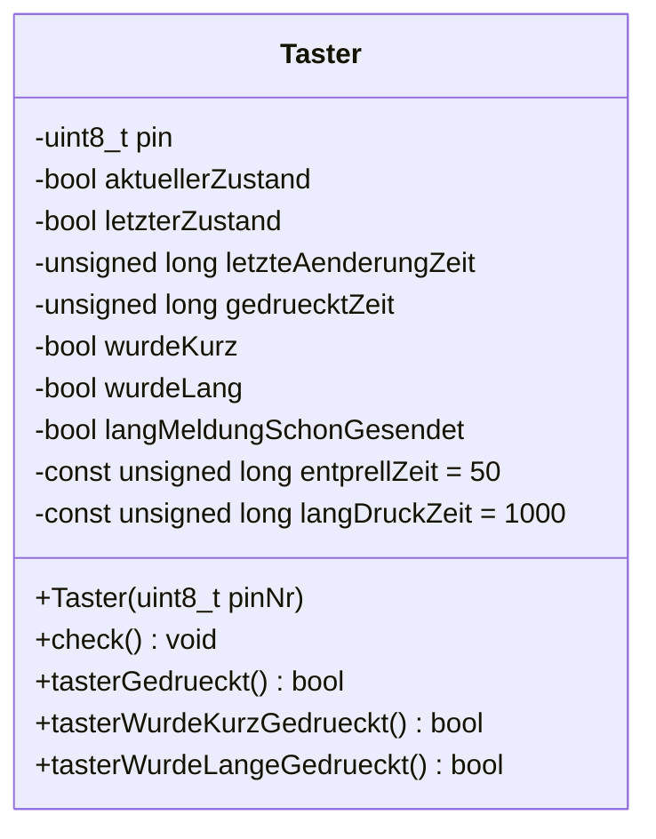
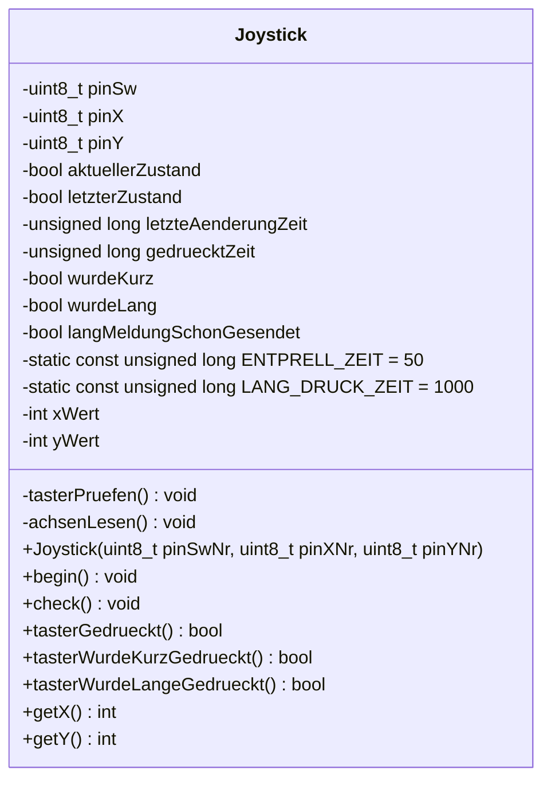
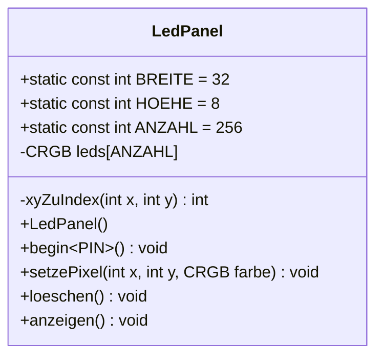

# UML-Klassendiagramme

Zurück zur [Übersicht](index.md).

## Klasse `Taster` (Vorjahr, Code gelöscht – nur noch als Referenz für den Umbau)

## Klasse `Joystick` (`src/Joystick.h`, `src/Joystick.cpp`)

Umbau der Klasse `Taster`: Tasterlogik übernommen (Pin heißt jetzt `pinSw`, Einlesen in private
Methode `tasterPruefen()` ausgelagert), ergänzt um zwei Achsen. Keine Vererbung, keine Komposition.

Objekt im Testprogramm: `joystick(14, 34, 35)`.

## Klasse `LedPanel` (`src/LedPanel.h`, `src/LedPanel.cpp`)

Ein LED-Panel 32×8 (WS2812, Vertical Zig-Zag) mit x/y-Koordinatensystem: (0,0) = links oben, x nach rechts, y nach unten.

Objekt im Testprogramm: `panel`, angemeldet mit `panel.begin<16>()`.
