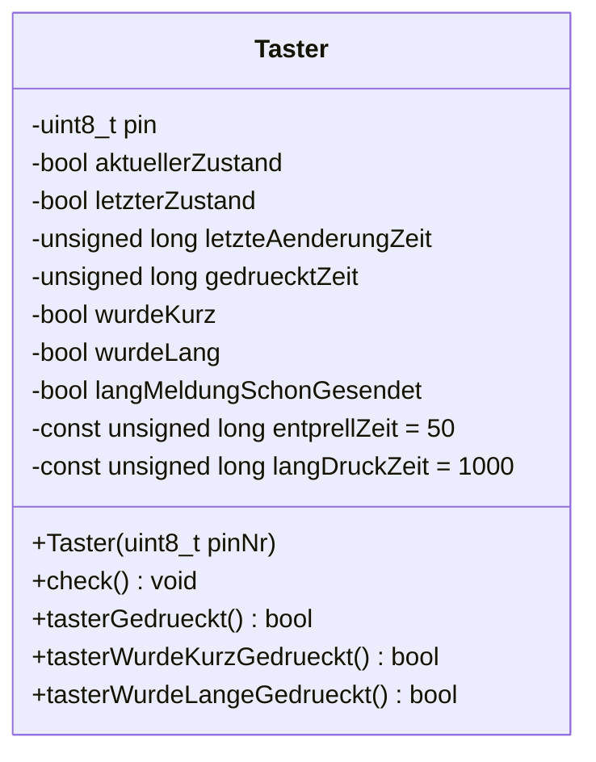
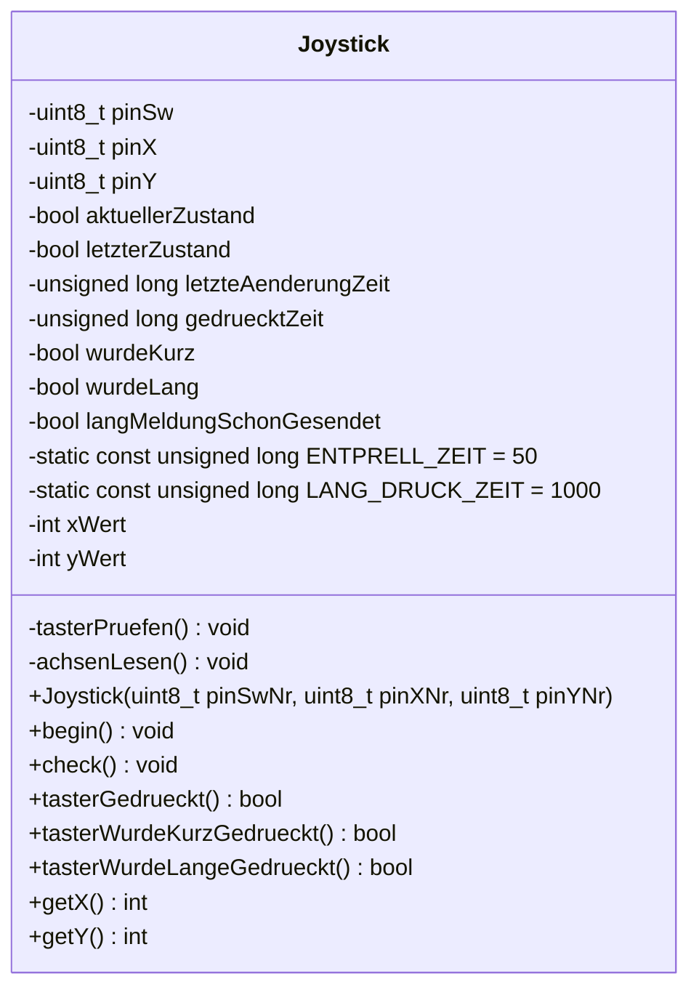
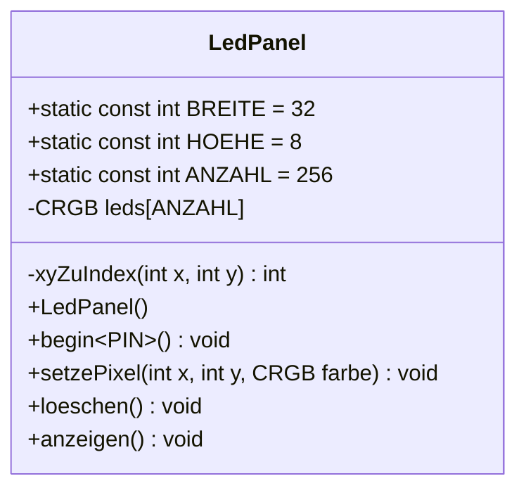
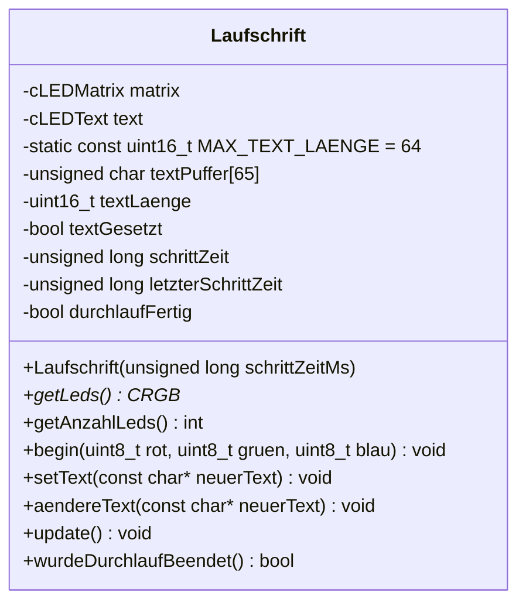

# UML-Klassendiagramme

Zurück zur [Übersicht](index.md).

## Klasse `Taster` (Vorjahr, Code gelöscht – nur noch als Referenz für den Umbau)

## Klasse `Joystick` (`src/Joystick.h`, `src/Joystick.cpp`)

Umbau der Klasse `Taster`: Tasterlogik übernommen (Pin heißt jetzt `pinSw`, Einlesen in private
Methode `tasterPruefen()` ausgelagert), ergänzt um zwei Achsen. Keine Vererbung, keine Komposition.

Objekt im Testprogramm: `joystick(14, 34, 35)`.

## Klasse `LedPanel` (`src/LedPanel.h`, `src/LedPanel.cpp`)

Ein LED-Panel 32×8 (WS2812, Vertical Zig-Zag) mit x/y-Koordinatensystem: (0,0) = links oben, x nach rechts, y nach unten.

Objekt im Testprogramm: `panel`, angemeldet mit `panel.begin<16>()`.

## Klasse `Laufschrift` (`src/Laufschrift.h`, `src/Laufschrift.cpp`) – Aufgabe 1

Lässt einen Text über **ein** Panel laufen. Nutzt **LEDMatrix** (Koordinaten → LED-Nummer, Vertical Zig-Zag) und
**LEDText** (Laufschrift, Schrift `FontMatrise` 5×7). Unabhängig von `LedPanel` (eigener LED-Speicher in `matrix`).
`matrix` ist vom Typ `cLEDMatrix<PANEL_BREITE, PANEL_HOEHE, VERTICAL_ZIGZAG_MATRIX>` mit 32 und −8
(negative Höhe = LED 0 links oben, passend zu T7).

| Methode | Beschreibung |
|---|---|
| `Laufschrift(schrittZeitMs)` | Speichert die Geschwindigkeit (ms pro Spalte). Kein Hardwarezugriff. |
| `getLeds()` / `getAnzahlLeds()` | LED-Speicher bzw. Anzahl (256) für `FastLED.addLeds<WS2812B, PIN, GRB>(…)` in `setup()`. |
| `begin(rot, gruen, blau)` | Schriftart, Textbereich (ganzes Panel) und Textfarbe setzen. Einmal nach `addLeds`. |
| `setText(text)` | Kopiert den Text (6 führende Leerzeichen, max. 64 Zeichen) in den eigenen Puffer, startet den Durchlauf neu. |
| `aendereText(text)` | Tauscht den Text **während** des Durchlaufs aus (kein Neustart). Länge bleibt gleich: kürzer → mit Leerzeichen aufgefüllt, länger → abgeschnitten. Geht, weil LEDText die sichtbaren Zeichen bei jedem Schritt neu aus dem Puffer liest. |
| `update()` | Alle `schrittZeit` ms eine Spalte weiter + `FastLED.show()`. Nicht blockierend, in jedem `loop()` aufrufen. |
| `wurdeDurchlaufBeendet()` | Einmalig `true`, wenn der Text komplett durchgelaufen ist. |

Objekt in Aufgabe 1: `laufschrift(50)`, angemeldet an GPIO 16.
