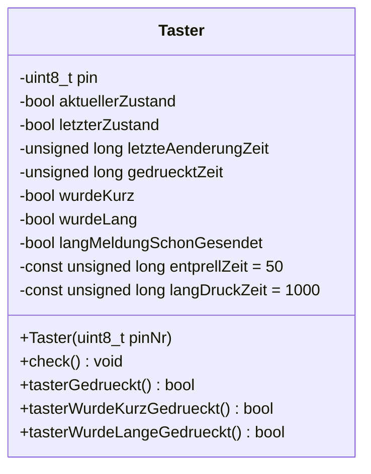
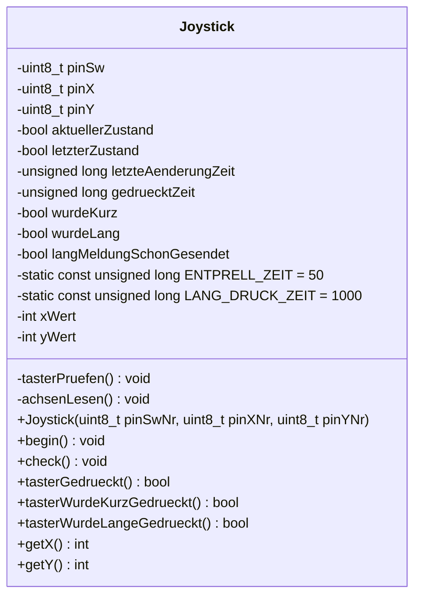
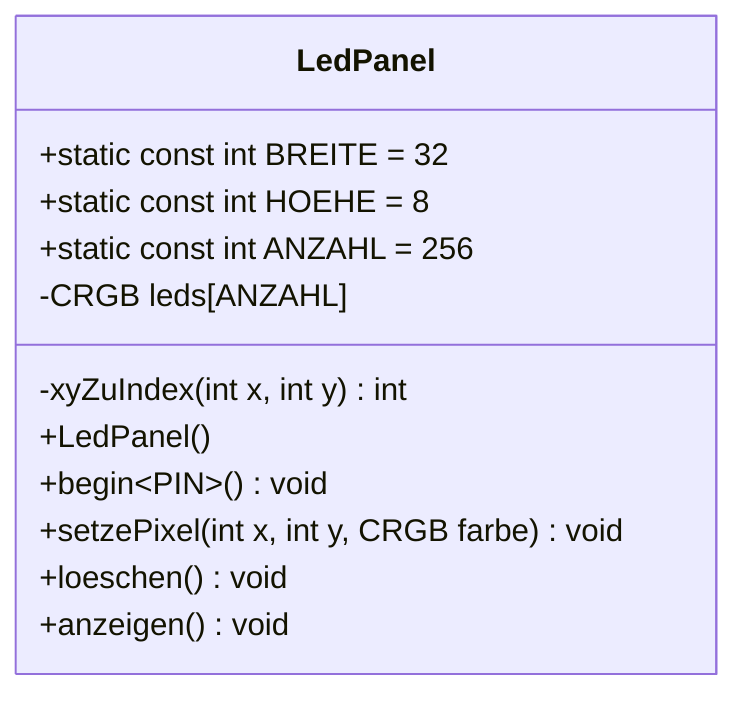
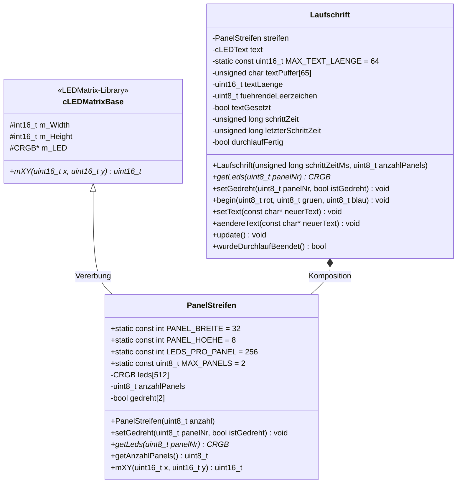
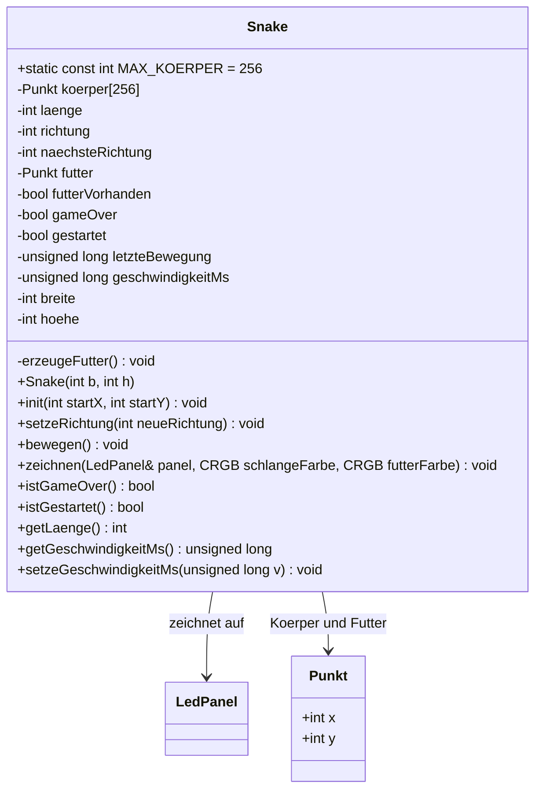

# UML-Klassendiagramme

Zurück zur [Übersicht](index.md).

## Klasse `Taster` (Vorjahr, Code gelöscht – nur noch als Referenz für den Umbau)

## Klasse `Joystick` (`src/Joystick.h`, `src/Joystick.cpp`)

Umbau der Klasse `Taster`: Tasterlogik übernommen (Pin heißt jetzt `pinSw`, Einlesen in private
Methode `tasterPruefen()` ausgelagert), ergänzt um zwei Achsen. Keine Vererbung, keine Komposition.

Objekt im Testprogramm: `joystick(14, 34, 35)`.

## Klasse `LedPanel` (`src/LedPanel.h`, `src/LedPanel.cpp`)

Ein LED-Panel 32×8 (WS2812, Vertical Zig-Zag) mit x/y-Koordinatensystem: (0,0) = links oben, x nach rechts, y nach unten.

Objekt im Testprogramm: `panel`, angemeldet mit `panel.begin<16>()`.

## Klasse `Laufschrift` (`src/Laufschrift.h`, `src/Laufschrift.cpp`) – Aufgabe 1

Lässt einen Text über **1 oder 2 Panels** laufen. Nutzt **LEDText** (Laufschrift, Schrift `FontMatrise` 5×7) und
zeichnet in einen `PanelStreifen` (eigene Unterklasse von `cLEDMatrixBase` aus LEDMatrix). Unabhängig von `LedPanel`.
Bei 2 Panels läuft der Text **zuerst über das obere Panel und dann unten weiter** (Streifen 64×8).

### `PanelStreifen` (`src/PanelStreifen.h`, `src/PanelStreifen.cpp`)

Fasst die Panels zu einem Streifen zusammen. Koordinaten wie bei LEDMatrix/LEDText: x nach rechts, **y = 0 unten**.

| Streifen-x | Panel | Data-Pin (Aufgabe 1) |
|---|---|---|
| 0..31 | Panel 0 = **unten** | GPIO 26 |
| 32..63 | Panel 1 = **oben** (180° gedreht) | GPIO 25 |

`mXY(x, y)` – Umrechnung Streifen-Koordinate → Index im LED-Speicher:
1. Panel = x / 32, lokales x = x % 32
2. `yOben = 7 − y` (LEDText zählt von unten, die Verdrahtung von oben)
3. Panel gedreht (180°): `lokalX = 31 − lokalX`, `yOben = 7 − yOben`
4. Zick-Zack wie `LedPanel::xyZuIndex` (T7): gerade Spalte `x·8 + yOben`, ungerade `x·8 + (7 − yOben)`
5. Index = Panel · 256 + Ergebnis

Ungedreht ergibt das für jedes Pixel denselben Index wie vorher `cLEDMatrix<32, −8, VERTICAL_ZIGZAG_MATRIX>`.

### Methoden `Laufschrift`

| Methode | Beschreibung |
|---|---|
| `Laufschrift(schrittZeitMs, anzahlPanels)` | Speichert Geschwindigkeit (ms pro Spalte) und legt den Streifen an (1 oder 2 Panels). Kein Hardwarezugriff. |
| `getLeds(panelNr)` | LED-Speicher von Panel 0 (unten) bzw. 1 (oben) für `FastLED.addLeds<WS2812B, PIN, GRB>(…, 256)`. |
| `setGedreht(panelNr, gedreht)` | Panel als um 180° gedreht markieren. |
| `begin(rot, gruen, blau)` | Schriftart, Textbereich (ganzer Streifen, 32 oder 64 breit) und Textfarbe setzen. Einmal nach `addLeds`. |
| `setText(text)` | Kopiert den Text (mit führenden Leerzeichen: 6 bei 1 Panel, 11 bei 2 Panels; max. 64 Zeichen) in den Puffer, startet neu. |
| `aendereText(text)` | Tauscht den Text **während** des Durchlaufs aus (kein Neustart). Länge bleibt gleich: kürzer → mit Leerzeichen aufgefüllt, länger → abgeschnitten. |
| `update()` | Alle `schrittZeit` ms eine Spalte weiter + `FastLED.show()` (sendet an alle Panels). Nicht blockierend. |
| `wurdeDurchlaufBeendet()` | Einmalig `true`, wenn der Text komplett durchgelaufen ist. |

Objekt in Aufgabe 1: `laufschrift(50, ANZAHL_PANELS)`; unten GPIO 26, oben GPIO 25 (gedreht).

## Klasse `Snake` (`src/Snake.h`, `src/Snake.cpp`) – Aufgabe 3

Einfaches Snake-Spiel auf **einem** Panel. Nutzt das x/y-Koordinatensystem von `LedPanel`
(`zeichnen()` bekommt ein `LedPanel&` übergeben), kein eigener LED-Speicher.

Hilfsstruktur `Punkt` mit `x` und `y`.

| Methode | Beschreibung |
|---|---|
| `Snake(b, h)` | Legt Spielfeldgröße fest (Standard 32×8). Kein Hardwarezugriff, noch kein Spielstart. |
| `init(startX, startY)` | Startet neu: 3 Segmente waagerecht, Kopf bei `(startX, startY)`, Richtung rechts, Futter wird zufällig gesetzt. |
| `setzeRichtung(r)` | 0 = rechts, 1 = unten, 2 = links, 3 = oben. Direkte Umkehr wird ignoriert. |
| `bewegen()` | Nicht blockierend: bewegt die Schlange alle `geschwindigkeitMs`. Prüft Wand- und Selbstkollision, frisst Futter (Schlange wächst, wird ab 80 ms etwas schneller). |
| `zeichnen(panel, …)` | Zeichnet Schlange (grün) und Futter (orange) über `setzePixel()`; nichts sichtbar bis `panel.anzeigen()`. |
| `istGameOver()` | `true` nach Wand- oder Selbstkollision. |

Objekt in Aufgabe 3: `snake(32, 8)`; Steuerung über `Joystick` (Schwellen 1500/2500, Totzone dazwischen),
Neustart nach Game Over per kurzem Tastendruck.
